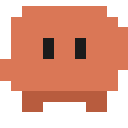
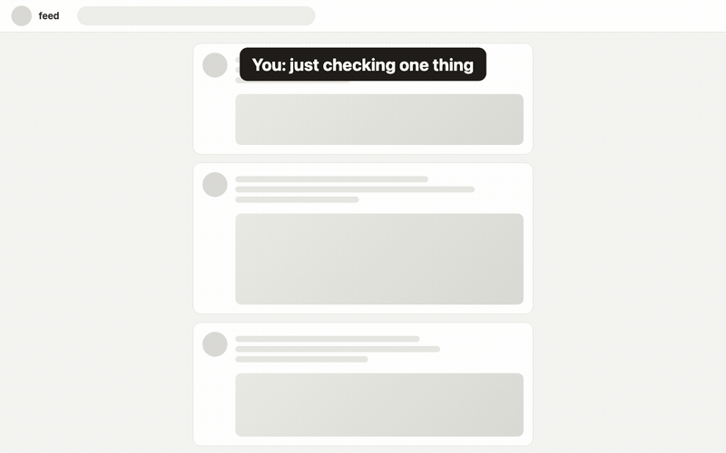

<p align="center">
  
</p>
<h1 align="center">Nudge</h1>
<p align="center">
  A pixel mascot waves at you in Chrome when Claude Code has a question, needs permission, or is done.<br>
  Ignore it and it gets annoyed. Free, open source, local only.
</p>
<p align="center">
  <a href="https://nudge-mascot.vercel.app/">Website</a> ·
  <a href="#install">Install</a> ·
  <a href="#escalation">Escalation</a> ·
  <a href="#reply-from-the-bubble">Reply</a> ·
  <a href="https://nudge-mascot.vercel.app/privacy">Privacy</a> ·
  <a href="https://github.com/sponsors/JayroldSoriano">Sponsor</a>
</p>

<p align="center"></p>

You start a task in Claude Code, switch to the browser "just for a second", and ten minutes later
Claude has been sitting on a permission prompt the whole time. Nudge fixes that.

```
Claude Code hook ──curl──▶ relay on 127.0.0.1 ──WebSocket──▶ extension ──▶ Nudge on your active tab
```

## Install

```sh
npx nudge-mascot setup
```

That copies the relay and hook into `~/.claude-nudge/`, adds the hooks to `~/.claude/settings.json`
(backup saved next to it), starts the relay and keeps it running at login (launchd on macOS,
systemd user service on Linux), and prints where to load the extension.

Then load the extension: open `chrome://extensions`, turn on **Developer mode**, click **Load unpacked**,
and pick `~/.claude-nudge/extension` (Chrome Web Store listing coming). Restart any running Claude Code
session and run:

```sh
npx nudge-mascot test            # a question
npx nudge-mascot test done       # done / permission / resolved
npx nudge-mascot status          # relay health + hook check
npx nudge-mascot uninstall       # removes everything it installed
```

Requires Node 18+ and Chrome 116+.

## What gets shown

| Event | Trigger | Bubble | Auto-dismiss |
| --- | --- | --- | --- |
| question | `AskUserQuestion` tool call, `agent_needs_input` | Question text plus the option labels | Never |
| permission | `permission_prompt` notification | Permission message | Never |
| done | `Stop` hook, `agent_completed` | Claude's last message (expandable) | After 20s (configurable) |
| idle | `idle_prompt` notification (60s of waiting) | Waiting message | After 20s; off by default |

Nudge appears on the active tab and follows you: switch tabs or windows and it re-appears there with
the same countdown. Dismissing it in one tab clears it everywhere. Answering in the terminal (which fires
`PostToolUse` or `UserPromptSubmit`, or, for a permission or question the approval hook was waiting on, ends that
hook: a Deny fires no `PostToolUse`, so the relay watches for the hook going away) resolves it everywhere, also
in a browser that was disconnected at the time (the relay tells it on reconnect). If a tab can't run content scripts
(`chrome://` pages, the Web Store), a system notification is used instead. Press Esc, click **Got it**,
or click Nudge to dismiss.

## Escalation

For questions and permissions, Claude is blocked until you act, so Nudge gets progressively harder to
ignore. The clock only runs while Chrome is the focused app; time in the terminal doesn't count.

| Level | After (default) | Nudge |
| --- | --- | --- |
| 0 | 0s | Corner wave, green antenna light |
| 1 | 15s | Walks to bottom-center, waves harder, hint shows how long you've kept Claude waiting |
| 2 | 30s | Grows 1.8x, annoyed face, foot tapping, red light, bubble turns red and shakes once |
| 3 | 60s | Short alarm (at most once a minute), hops and roams along the bottom edge |

Modes: **Off**, **Gentle** (levels 1 and 2), **Full chaos** (adds level 3). From level 1 the bubble
has a **Snooze** button (5 minutes by default). "Done" nudges never escalate. A "done" from another
session never replaces a blocking question; it becomes a system notification.

Nudge never blocks the page: only the bubble and the mascot catch clicks. Sound needs you to have
interacted with the page since it loaded (Chrome's autoplay policy); the visual tiers don't depend on it.

## Reply from the bubble

`npx nudge-mascot setup` installs the approval hooks (`PermissionRequest`, and `PreToolUse` on
`AskUserQuestion`, both with Claude Code's 600 s hook timeout), so you can answer Claude without going back
to the terminal. Installs from before this change get them on the next `setup`, or from `npx nudge-mascot pair`.

A permission shows **Allow** and **Deny**; a question shows its choices as buttons, grouped under each
question. One question answers on tap; several questions, or a multi-select one, take your picks and a **Send answers** button. The bubble says "Sent to Claude" and
goes away everywhere, and a paired phone marks it answered too. Answer on the phone instead and the bubble
says "Answered on your phone". The terminal prompt still works either way; answer there and the bubble goes away,
or, if you tap it in the same moment, it says "Answered in the terminal". With several questions, the relay
only accepts an answer for every one of them. Without the approval hook, permissions show "Answer in the
terminal"; without its `PreToolUse` half, questions show their choices as labels only and the hook doesn't wait. Try it with **Preview nudge** or the popup's test buttons
(`npx nudge-mascot test approve`, `test question`, `test questions`).

The approval hook only waits when something can answer: the relay tells it whether the extension is
connected or a phone is paired. With Chrome closed (or the extension off, or the relay down) and no phone,
it returns at once and the terminal prompt appears immediately, exactly as without Nudge. `npx nudge-mascot
unpair` keeps the approval hooks for the bubble; `uninstall` removes them.

## Settings (extension popup)

Which event kinds to show, sound on/off, auto-dismiss seconds, corner position, relay port,
escalation mode, level timings, level-3 sound, snooze length. Change the port with
`CLAUDE_NUDGE_PORT=...` before `setup` and match it in the popup.

## Privacy

Everything stays on your machine. The relay binds to `127.0.0.1` and only accepts WebSocket or
`/events` requests from `chrome-extension://` origins (or none, as curl sends), so web pages cannot
read your Claude messages. The content script renders inside a closed shadow root and never reads
the page. Messages are clipped to 1200 characters before leaving the relay. No accounts, no analytics.
Full policy: [privacy.html](https://nudge-mascot.vercel.app/privacy).

## Project layout

| Path | What it is |
| --- | --- |
| `bin/nudge.js` | The CLI: `setup`, `start`, `status`, `test`, `uninstall`. |
| `hooks/nudge-hook.sh` | Claude Code hook. Forwards the hook's JSON to the relay with curl. Fire-and-forget, 2s timeout, never blocks Claude. |
| `relay/server.js` | Zero-dependency Node relay with its own minimal WebSocket server. Normalizes `Stop`, `Notification`, `AskUserQuestion`, `PostToolUse`, `UserPromptSubmit`. |
| `extension/` | Chrome extension (Manifest V3): service worker holds the WebSocket and the escalation clock; content script draws the mascot in a closed shadow root; popup has settings. |
| `docs/` | Landing page and privacy policy (GitHub Pages). |
| `scripts/make-assets.js` | Renders the demo GIF/MP4, Web Store screenshots, and promo tile with headless Chrome and ffmpeg. |
| `scripts/pack-extension.sh` | Zips the extension for Web Store upload into `dist/`. |

## Development

```sh
git clone https://github.com/JayroldSoriano/nudge-mascot && cd nudge-mascot
node bin/nudge.js setup            # same as npx, from the checkout
npm run icons                      # regenerate extension/icons
npm run assets                     # demo.gif, mp4s, store screenshots (needs Chrome + ffmpeg)
npm run pack                       # dist/nudge-<version>.zip
curl -s http://127.0.0.1:47831/health
```

After editing the extension, click its **Reload** icon on `chrome://extensions`; a page reload is not enough.

## Roadmap

- Reply to `AskUserQuestion` and approve permissions from the bubble.
- "Jump back" button that focuses the terminal app.
- Multi-session view when several Claude Code sessions run at once.
- Mascot and sound packs. Waiting stats.
- Desktop apps reusing the same relay protocol. Firefox port.

## License

MIT. Independent project, not affiliated with or endorsed by Anthropic. "Claude" and "Claude Code"
are trademarks of Anthropic.
